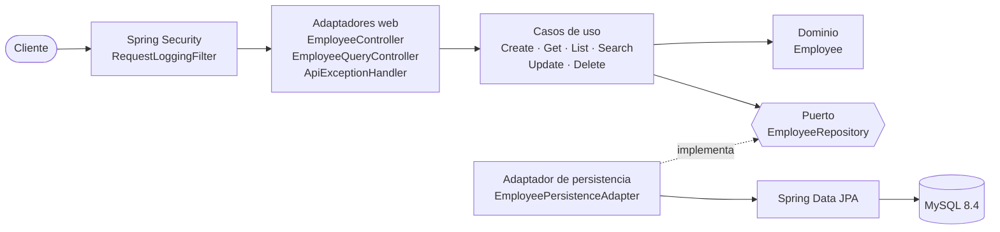

# Employee Service

Microservicio REST para gestionar empleados: alta individual o por lotes, consulta, búsqueda parcial por nombre, actualización total o parcial y baja. Está construido con arquitectura hexagonal y principios SOLID, y tiene seguridad, observabilidad, contenedores y un pipeline de CI.

**Stack:** Java 17 · Spring Boot 2.7.18 · Spring Data JPA / Hibernate · MySQL 8.4 · Spring Security · springdoc-openapi · JUnit 5 · Mockito · Maven · Docker · GitHub Actions.

## Contenido

1. [Endpoints](#endpoints)
2. [Arquitectura](#arquitectura)
3. [Requisitos](#requisitos)
4. [Configuración](#configuración)
5. [Ejecución local](#ejecución-local)
6. [Ejecución con Docker](#ejecución-con-docker)
7. [Uso de la API](#uso-de-la-api)
8. [Documentación de la API](#documentación-de-la-api)
9. [Pruebas](#pruebas)
10. [Observabilidad](#observabilidad)
11. [Seguridad y DevSecOps](#seguridad-y-devsecops)
12. [CI/CD](#cicd)
13. [Git Flow](#git-flow)
14. [Decisiones y limitaciones](#decisiones-y-limitaciones)
15. [Evidencias](#evidencias)

## Endpoints

| Método | Ruta | Descripción | Rol | Respuestas |
|---|---|---|---|---|
| `GET` | `/employees` | Todos los empleados, activos e inactivos, ordenados por ID | `READER` o `ADMIN` | `200` |
| `GET` | `/employees/{id}` | Detalle de un empleado | `READER` o `ADMIN` | `200`, `400`, `404` |
| `GET` | `/employees/search?name={name}` | Búsqueda parcial en cualquiera de los cuatro campos de nombre, sin distinguir mayúsculas | `READER` o `ADMIN` | `200`, `400` |
| `POST` | `/employees` | Alta de uno o varios empleados en una misma petición | `ADMIN` | `201`, `200`, `400`, `413`, `503` |
| `PUT` | `/employees/{id}` | Actualiza todos o algunos campos | `ADMIN` | `200`, `400`, `404`, `409` |
| `DELETE` | `/employees/{id}` | Elimina un empleado | `ADMIN` | `204`, `400`, `404`, `409` |

Además: `/actuator/health`, `/actuator/health/liveness` y `/actuator/health/readiness` (públicos), Swagger UI en `/swagger-ui.html` y el contrato OpenAPI en `/v3/api-docs`.

### Modelo de datos

| Campo | Tipo | Reglas |
|---|---|---|
| `id` | número | Lo asigna la base de datos |
| `firstName` | texto | Obligatorio |
| `middleName` | texto | Opcional |
| `paternalLastName` | texto | Obligatorio |
| `maternalLastName` | texto | Opcional |
| `age` | número | Se calcula desde `birthDate`. Si el cliente lo envía, debe coincidir |
| `sex` | texto | Obligatorio |
| `birthDate` | `dd-MM-yyyy` | Obligatorio, no puede ser futura |
| `jobTitle` | texto | Obligatorio |
| `createdAt` | fecha y hora ISO-8601 | Automático al dar de alta; no se modifica |
| `active` | booleano | Obligatorio en el alta |

Los seis campos de texto admiten hasta 255 caracteres Unicode cada uno. Una fecha imposible, por ejemplo `29-02-2023`, se rechaza; `29-02-2024` sí es válida. En un alta por lote el error corresponde solo a ese elemento.

## Arquitectura

Arquitectura hexagonal (puertos y adaptadores). El dominio y los casos de uso no dependen de Spring Web, de JPA ni de Spring Security. Lombok sí se usa en esas capas, pero solo actúa al compilar.



```text
src/main/java/com/employee/employeeservice
├── domain/            Employee (inmutable, calcula la edad y valida sus reglas), InvalidEmployeeException
├── application/
│   ├── port/in/       Comandos de entrada: CreateEmployeeCommand, UpdateEmployeeCommand
│   ├── port/out/      EmployeeRepository: el puerto que la aplicación necesita
│   ├── service/       Un servicio por caso de uso
│   └── exception/     EmployeeNotFoundException, InvalidSearchTermException
├── controller/        Adaptadores REST y traducción de excepciones a HTTP
├── dto/               Contrato JSON (requests, responses y errores)
├── infrastructure/
│   ├── persistence/   Entidad JPA, Spring Data y el adaptador que implementa el puerto
│   ├── idempotency/   Alta idempotente por requestId
│   └── logging/       Registro de peticiones con correlation ID
└── config/            Ensamblado de beans, seguridad, usuarios y OpenAPI
```

### SOLID en el proyecto

- **S (responsabilidad única):**
  - cada caso de uso es una clase;
  - las lecturas y las escrituras van en controladores distintos;
  - los errores se traducen en un solo `@RestControllerAdvice`.
- **O (abierto/cerrado):** un caso de uso nuevo es un servicio nuevo y un `@Bean`, sin tocar los existentes.
- **L (sustitución de Liskov):** cualquier implementación del puerto sirve. Las pruebas de los servicios usan un mock de Mockito en lugar del adaptador JPA.
- **I (segregación de interfaces):** el puerto expone solo las seis operaciones que la aplicación usa, no las decenas de métodos de `JpaRepository`. `SpringDataEmployeeRepository` queda encerrado en el adaptador.
- **D (inversión de dependencias):** los servicios reciben `EmployeeRepository` por constructor. `EmployeeConfiguration` los ensambla, así que no llevan anotaciones de Spring.

## Requisitos

- **Java:** JDK 17.
- **Maven:** 3.9 o superior, o IntelliJ IDEA con su Maven integrado.
- **Base de datos:** MySQL 8.4 para ejecutar en local, o Docker Desktop para levantar todo con Docker Compose.

## Configuración

La aplicación lee variables de entorno. En local las toma de un archivo `.env` en la raíz, que Git ignora; las variables reales del sistema (Docker, CI) tienen prioridad sobre ese archivo.

```bash
cp .env.example .env
```

| Variable | Valor por defecto | Descripción |
|---|---|---|
| `DB_HOST` / `DB_PORT` / `DB_NAME` | `127.0.0.1` / `3306` / `employee_service` | Conexión a MySQL |
| `DB_USER` | `employee_app` | Usuario de la aplicación, no `root` |
| `DB_PASSWORD` | — | **Obligatoria** |
| `JPA_DDL_AUTO` | `validate` | `update` en desarrollo; `validate` en CI y producción |
| `API_ADMIN_USER` / `API_READER_USER` | `admin` / `reader` | Usuarios de la API |
| `API_ADMIN_PASSWORD` / `API_READER_PASSWORD` | — | **Obligatorias.** Si faltan o están en blanco, la aplicación no arranca |
| `LOG_LEVEL` / `SQL_LOG_LEVEL` | `INFO` / `WARN` | Nivel de log de la aplicación y de las consultas SQL |
| `LOG_FILE` | `logs/employee-service.log` | Vacío = solo salida estándar |
| `API_DOCS_ENABLED` | `true` | `false` oculta Swagger y `/v3/api-docs` |

Usa contraseñas sin `$`, `\` ni comillas: Docker Compose y Spring leen el mismo `.env` y tratan esos caracteres de forma distinta.

## Ejecución local

**1. Crea el esquema y el usuario** (como `root` en MySQL):

```sql
CREATE DATABASE employee_service CHARACTER SET utf8mb4;
CREATE USER 'employee_app'@'localhost' IDENTIFIED BY '<contraseña>';
GRANT ALL PRIVILEGES ON employee_service.* TO 'employee_app'@'localhost';
```

**2. Crea las tablas** con los scripts versionados (pide la contraseña de `employee_app`):

```bash
cat src/main/resources/db/mysql/*.sql | mysql -h 127.0.0.1 -u employee_app -p employee_service
```

En bases creadas con la versión anterior, la purga funciona con la tabla existente. Para indexar el vencimiento en esas instalaciones, comprueba si existe `ix_receipts_created_at` con `SHOW INDEX FROM employee_creation_receipts`. Si falta, añádelo una vez con `CREATE INDEX ix_receipts_created_at ON employee_creation_receipts (created_at)`.

**3. Completa el `.env`** con `DB_PASSWORD`, `API_ADMIN_PASSWORD` y `API_READER_PASSWORD`.

**4. Compila, prueba y arranca:**

```bash
mvn -B verify
```
```bash
java -jar target/employee-service-1.0-SNAPSHOT.jar
```

El servicio queda en `http://localhost:8080`. Desde IntelliJ también se puede ejecutar `EmployeeServiceApplication`, que lee el mismo `.env`.

## Ejecución con Docker

```bash
docker compose up --build -d
```

Compose levanta dos contenedores:

- **MySQL 8.4:** crea el usuario `employee_app` y las dos tablas en el primer arranque, con una contraseña de `root` aleatoria. No publica su puerto.
- **El servicio:** se construye con un `Dockerfile` multi-stage, corre con un usuario sin privilegios y espera a que MySQL esté sano. Publica el puerto HTTP en `127.0.0.1` para la evaluación local. El acceso desde otra máquina requiere un proxy que termine TLS antes de reenviar las credenciales Basic.

Usa los valores de tu `.env`.

```bash
docker compose ps
```
```bash
docker compose logs -f app
```
```bash
docker compose down
```

`docker compose down -v` borra también los datos. Si el puerto 8080 está ocupado, arranca con `APP_PORT=8081 docker compose up --build -d`.

## Uso de la API

Todas las peticiones a `/employees` usan HTTP Basic. Para estos ejemplos, carga tu `.env` en la terminal:

```bash
set -a; . ./.env; set +a
```

**Alta por lotes:**

```bash
curl -i -u "$API_ADMIN_USER:$API_ADMIN_PASSWORD" -H 'Content-Type: application/json' \
  -d '{"employees":[{"requestId":"0bf9286e-5898-4d13-af0b-ed441ef1d4e2","firstName":"Ana","middleName":"Maria","paternalLastName":"Garcia","maternalLastName":"Lopez","sex":"F","birthDate":"14-03-1995","jobTitle":"Developer","active":true},{"firstName":"Eva","paternalLastName":"Ruiz","sex":"F","birthDate":"02-11-1990","jobTitle":"Analyst","active":false}]}' \
  http://localhost:8080/employees
```

Se admiten de 1 a 100 empleados y hasta 1 MiB (1 048 576 bytes) de JSON por petición. Un lote mayor se rechaza completo antes de procesar empleados. Dentro de esos límites, cada elemento se valida y se guarda por separado. La respuesta informa el resultado de cada uno, en el orden en que llegaron:

- **Estados posibles de cada elemento:** `CREATED`, `REPLAYED`, `CONFLICT`, `INVALID` o `PERSISTENCE_ERROR`.
- **Código HTTP:** `201` cuando se crean todos. Si la conexión a la base falla para todos, se devuelve `503` con el resultado de cada posición. Los demás lotes procesados devuelven `200`, incluidos los mixtos y las repeticiones.
- **`requestId` (opcional):** protege los reintentos durante 24 horas desde el alta confirmada.
  - el mismo `requestId` con los mismos datos devuelve `REPLAYED` con el empleado original y no crea un duplicado;
  - con datos distintos dentro de la ventana, devuelve `CONFLICT`.
  - si se elimina el empleado, un reintento idéntico dentro de la ventana devuelve la respuesta original y el empleado sigue eliminado. Al vencer las 24 horas, la clave vuelve a estar disponible. Reenviar el alta puede crear otro ID, incluso si el anterior sigue existiendo.
  - el servicio elimina los recibos vencidos al iniciar y luego cada hora, en bloques de 500. La caducidad de la clave se comprueba también al recibir el reintento, aunque la purga física siga pendiente.

Los ejemplos siguientes usan el `id` del primer empleado de esa respuesta. Guárdalo en la terminal; por ejemplo, si la respuesta trae `"id":27`:

```bash
ID=27
```

**Consultas:**

```bash
curl -i -u "$API_READER_USER:$API_READER_PASSWORD" http://localhost:8080/employees
```
```bash
curl -i -u "$API_READER_USER:$API_READER_PASSWORD" http://localhost:8080/employees/$ID
```
```bash
curl -i -u "$API_READER_USER:$API_READER_PASSWORD" 'http://localhost:8080/employees/search?name=gar'
```

**Actualización parcial:** los campos omitidos o `null` conservan su valor; `id` y `createdAt` nunca cambian.

```bash
curl -i -u "$API_ADMIN_USER:$API_ADMIN_PASSWORD" -X PUT -H 'Content-Type: application/json' \
  -d '{"jobTitle":"Architect","active":false}' http://localhost:8080/employees/$ID
```

**Baja:** responde `204` sin cuerpo; un segundo intento responde `404`.

```bash
curl -i -u "$API_ADMIN_USER:$API_ADMIN_PASSWORD" -X DELETE http://localhost:8080/employees/$ID
```

### Errores

Todos los errores tienen el mismo formato:

```json
{"error": "EMPLOYEE_NOT_FOUND", "message": "Employee with ID 1 was not found"}
```

| HTTP | `error` | Cuándo |
|---|---|---|
| `400` | `VALIDATION_FAILED` | Un campo no cumple sus reglas, o la cantidad de empleados está fuera del intervalo de 1 a 100 |
| `400` | `MALFORMED_REQUEST` | JSON ilegible o fecha que no usa `dd-MM-yyyy` |
| `400` | `INVALID_EMPLOYEE` | Regla de dominio, como una edad que no coincide con la fecha de nacimiento |
| `400` | `INVALID_PARAMETER` | ID no numérico |
| `400` | `MISSING_PARAMETER` / `INVALID_SEARCH_TERM` | Búsqueda sin `name`, en blanco o de más de 100 caracteres |
| `401` | `UNAUTHORIZED` | Sin credenciales o con credenciales incorrectas |
| `403` | `FORBIDDEN` | El rol no permite la operación |
| `404` | `EMPLOYEE_NOT_FOUND` | El ID no existe |
| `409` | `CONCURRENT_MODIFICATION` | Conflicto de bloqueo al actualizar o borrar. La petición se puede reintentar |
| `413` | `PAYLOAD_TOO_LARGE` | El cuerpo del alta supera 1 MiB |

En el alta por lotes, los errores de cada elemento van dentro de su resultado y no detienen a los demás.

## Documentación de la API

- **Swagger UI:** http://localhost:8080/swagger-ui.html. El botón **Authorize** acepta las credenciales de HTTP Basic.
- **Contrato OpenAPI 3:** http://localhost:8080/v3/api-docs.
- **Colección de Postman:** [docs/postman/employee-service.postman_collection.json](docs/postman/employee-service.postman_collection.json).
  - **Contenido:** 25 peticiones con 55 aserciones, en 6 carpetas que se ejecutan en orden: health, alta, consulta, actualización, seguridad y limpieza. La última carpeta elimina los empleados creados por esa corrida y comprueba los casos de ID ausente con un ID recién eliminado.
  - **Contraseñas:** captúralas en *Current value* de las variables `adminPassword` y `readerPassword`; la colección no las guarda.
  - **Ejecución desde la terminal:**

```bash
npx newman@6.2.1 run docs/postman/employee-service.postman_collection.json \
  --env-var adminPassword="$API_ADMIN_PASSWORD" --env-var readerPassword="$API_READER_PASSWORD"
```

## Pruebas

```bash
mvn -B verify
```

Son **83 pruebas** con JUnit 5:

| Tipo | Pruebas | Qué cubren | Necesita MySQL |
|---|---|---|---|
| Unitarias (JUnit 5 y Mockito) | 35 | Reglas del dominio, cada caso de uso con el puerto simulado, el filtro de logging y la configuración de usuarios | No |
| Web (`@WebMvcTest`) | 21 | Contrato HTTP de cada endpoint, códigos de estado, validaciones, errores y reglas de seguridad | No |
| Integración (`@SpringBootTest`, `@DataJpaTest`) | 27 | Flujo completo contra MySQL: alta parcial e idempotente (también con peticiones simultáneas), búsqueda, actualización, baja, mapeo JPA, OpenAPI, health checks y HTTP Basic real | Sí |

Las pruebas de integración usan una marca única en `jobTitle` y borran sus datos al terminar, así que pueden correr contra la base de desarrollo. En CI corren contra un MySQL desechable con `JPA_DDL_AUTO=validate`.

## Observabilidad

- **Health checks** (públicos y sin detalles internos):
  - `/actuator/health/liveness` indica si el proceso está vivo;
  - `/actuator/health/readiness` incluye MySQL. Si la base cae, el servicio deja de recibir tráfico (`503`) sin que lo reinicien en bucle.
- **Logs:**
  - niveles configurables por variable de entorno;
  - fecha en ISO-8601 con zona horaria;
  - archivo rotativo de 10 MB con 7 de historial; en contenedor, solo salida estándar.
- **Registro de peticiones:** una línea por petición con método, ruta, status, duración y headers.

  ```text
  INFO [demo-001] ... RequestLoggingFilter : HTTP GET /employees/search -> 200 in 35 ms headers={accept=*/*, authorization=***, ...}
  ```

- **Correlation ID:**
  - se reutiliza el `X-Correlation-Id` del cliente si es válido, o se genera uno;
  - se devuelve en la respuesta;
  - aparece en **todas** las líneas de log de esa petición.

## Seguridad y DevSecOps

- **Acceso:**
  - HTTP Basic sin sesión, con dos roles: `READER` (solo lectura) y `ADMIN` (lectura y escritura);
  - contraseñas guardadas en memoria como hash BCrypt;
  - la aplicación no arranca si falta alguna contraseña o está en blanco.
- **CSRF desactivado a propósito:** no hay cookie de sesión de la que un sitio externo pueda aprovecharse.
- **Respuestas:** cabeceras de seguridad (`X-Content-Type-Options`, `X-Frame-Options`, `Cache-Control: no-store`), y `401`/`403` en el mismo formato JSON que los demás errores.
- **Logs:**
  - los únicos valores registrados son `Accept`, `Content-Type` y el identificador de correlación validado. Para las demás cabeceras se registra el nombre con `***`;
  - los saltos de línea se neutralizan para evitar inyección en logs;
  - no se registran el query string ni el cuerpo, porque pueden traer datos personales.
- **Errores:** los mensajes no exponen detalles internos (clases de Jackson, valores rechazados ni trazas).
- **Superficie expuesta:** Actuator solo publica `health`. La documentación se puede apagar con `API_DOCS_ENABLED=false`.
- **Secretos:** fuera del repositorio. `.env` está en `.gitignore` y en `.dockerignore`, y las credenciales llegan como variables al arrancar.
- **Contenedores:**
  - imagen final solo con el JRE y el jar, con un usuario sin privilegios;
  - MySQL sin puerto publicado;
  - la aplicación usa un usuario de base de datos con acceso a un solo esquema.
- **Pipeline:** permisos mínimos (`contents: read`) y escaneo de la imagen con Trivy.

## CI/CD

[`.github/workflows/ci.yml`](.github/workflows/ci.yml) se ejecuta en cada push a `main`, `develop` y `feature/**`, y en cada pull request hacia `main` y `develop`:

1. **`build-test`:**
   - levanta un MySQL 8.4 desechable y crea el esquema con los scripts versionados;
   - ejecuta `mvn -B verify` con `JPA_DDL_AUTO=validate`, así que si la entidad y el script no coinciden, el pipeline falla;
   - publica los reportes de pruebas y el jar como artefactos.
2. **`docker`:** construye la imagen y la escanea con Trivy (`CRITICAL` y `HIGH`).

## Git Flow

- **Ramas:** `main` (releases), `develop` (integración) y una rama `feature/*` por funcionalidad, integrada con `git merge --no-ff`.
- **Commits atómicos:** cada uno agrupa un solo cambio, con [Conventional Commits](https://www.conventionalcommits.org/) (`feat`, `refactor`, `build`, `ci`, `docs`, `chore`).

```bash
git log --oneline --graph --first-parent develop
```

## Decisiones y limitaciones

- **La edad no se guarda:** se calcula desde `birthDate`. Guardarla la dejaría desactualizada cada año.
- **Alta por lotes con resultado por elemento:** un elemento inválido no rechaza a los demás. El `requestId` protege los reintentos durante 24 horas, incluso con peticiones simultáneas.
- **`PUT` parcial:** el enunciado pide actualizar "todos o algunos" campos con `PUT`. Como `null` significa "conservar", el segundo nombre y el apellido materno no se pueden borrar. En una API propia usaría `PATCH` con JSON Merge Patch (RFC 7396).
- **Actualizaciones concurrentes:** cada `PUT` bloquea la fila por ID en MySQL, lee sus valores vigentes y aplica el cambio en la misma transacción. Dos peticiones que tocan campos distintos conservan ambos cambios. Para un mismo campo prevalece la última escritura completada. Un conflicto de bloqueo devuelve `409`.
- **Spring Boot 2.7 sin soporte:** la versión la pide el enunciado. Por eso el escaneo de Trivy solo reporta: una migración a Spring Boot 3 permitiría hacerlo bloqueante.
- **Siguiente paso de seguridad:** OAuth2 Resource Server con JWT de un proveedor de identidad, para que el servicio no guarde contraseñas. HTTP Basic solo es aceptable detrás de HTTPS.
- **Siguiente paso del esquema:** migraciones con Flyway, partiendo de los scripts ya versionados.
- **Simplificaciones de la arquitectura:**
  - los controladores dependen de los servicios concretos, sin interfaces de puerto de entrada;
  - `IdempotentEmployeeCreator` reutiliza el DTO de respuesta web para guardar los recibos de idempotencia.

  Son concesiones conscientes para un servicio de este tamaño.

## Evidencias

Las capturas y grabaciones de funcionamiento están en [`docs/evidence/`](docs/evidence/).
